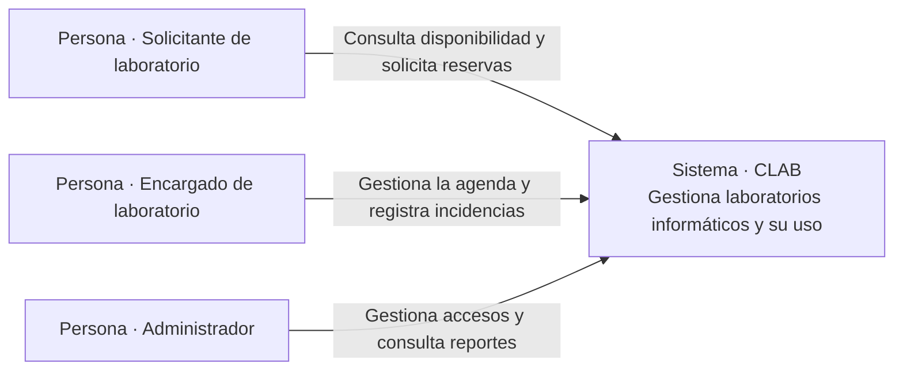
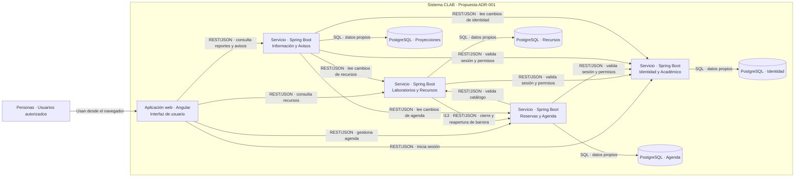
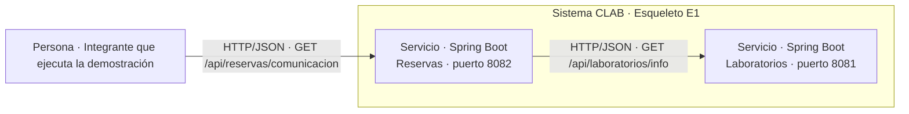

# Diagramas C4 de CLAB

Borrador de revisión del rol de Arquitectura, basado en el ADR-001 propuesto.
Validar los actores y sus relaciones con el bosquejo y el levantamiento del equipo.

## Nivel 1. Contexto de CLAB

## Nivel 2. Contenedores de la arquitectura objetivo

Las flechas indican quién inicia cada interacción. Cada cilindro representa un
almacén lógico. La consulta de cambios se realiza en segundo plano y alimenta
las proyecciones de Información y Avisos.

I13 concreta RF-P04: el catálogo publica fuera de servicio solo después de
confirmar la barrera en Reservas. Ante una respuesta desconocida conserva el
trámite pendiente y consulta o reintenta el mismo identificador y revisión.
La reapertura pasa primero a apertura pendiente y después retira únicamente la
barrera operativa; no cancela reservas ni elimina otros bloqueos. El manejador
I13 no vuelve a validar el catálogo por I09, evitando una llamada circular.
El protocolo y sus condiciones de seguridad se especifican en ADR-001.
Los editables draw.io y sus figuras PDF siguen siendo las vistas para el informe.

## Nivel 2. Contenedores implementados en E1

Los puertos indicados son los predeterminados. Esta vista representa únicamente
la comprobación de comunicación de E1. El catálogo, la agenda persistente y la
interfaz del diagrama objetivo son parte de la propuesta.

Asistencia de IA. OpenAI Codex preparó el borrador a partir del ADR-001, el
README y los controladores de E1. Las relaciones de la arquitectura objetivo
quedan sujetas a revisión del equipo.

La ampliación I13 y su descripción se prepararon con asistencia de OpenAI
GPT-6.1 Sol; se conserva el borrador base y no se afirma ejecución de este flujo.
